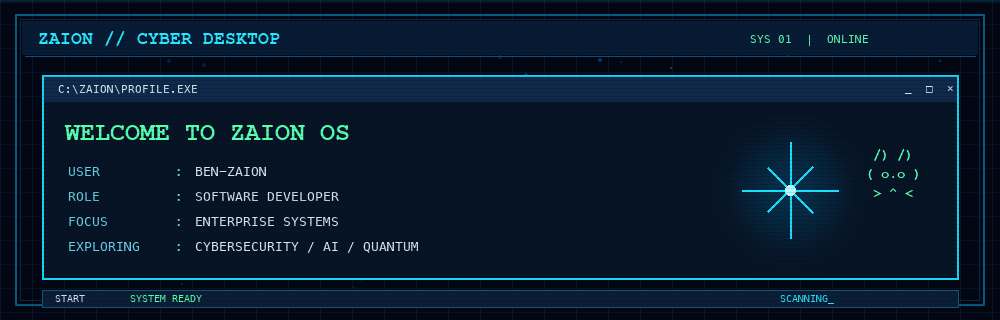

<!-- 
<div align="center">


# `Ben-Zaion.exe` 🐇

**SOFTWARE DEVELOPER**

</div>


## `C:\ZAION\INSTALLED_COMPONENTS`

**Programming**

`COBOL` · `Java` · `C#` · `.NET` · `Python`

**Enterprise Systems**

`IBM i / AS400` · `DB2` · `SQL` · `PL/SQL`

**Tools**

`Git` · `GitHub` · `VS Code` · `Linux`

## `C:\ZAION\CONTRIBUTION.EXE`

<div align="center">


</div>

--- -->
<div align="center">





</div>

```diff
+ C:\ZAION> sysinfo --profile
```

<!-- |  |  |
| --- | --- |
| 👤 `user` | **Ben Zaion** |
| 💼 `role` | Software Developer |
| 🖥️ `stack` | COBOL · Java · C# / .NET · Python |
| 🗄️ `data` | IBM i / AS400 · DB2 · SQL · PL/SQL |
| 🛠️ `tools` | Git · GitHub · VS Code · Linux |
| 📟 `status` | 🟢 ONLINE — open to collaborate | -->


<div align="center">




</div>

```diff
+ C:\ZAION> run contribution.exe
```

<div align="center">


</div>

<div align="center">

[](https://github.com/Ben-Zaion)


</div>
