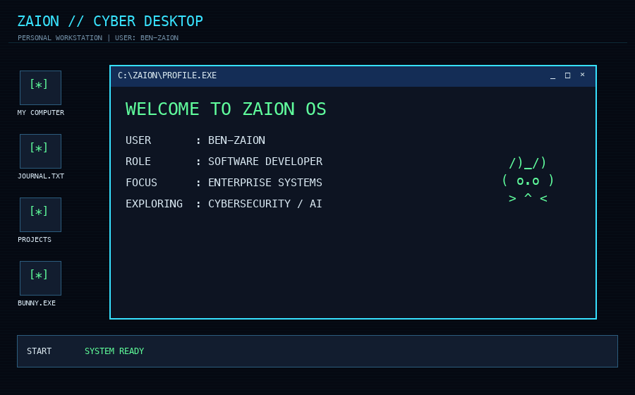

<div align="center">



# `Ben-Zaion.exe` 🐇

**SOFTWARE DEVELOPER // DIGITAL EXPLORER**

[GitHub](https://github.com/Ben-Zaion) · Thailand · Always Learning

</div>

```text
╔══════════════════════════════════════════════════════════════╗
║ ZAION OS 98                              [_] [□] [X]         ║
╠══════════════════════════════════════════════════════════════╣
║                                                              ║
║  DESKTOP                                                     ║
║                                                              ║
║  [▣] MY COMPUTER       [▤] JOURNAL.TXT                       ║
║                                                              ║
║  [▧] PROJECTS          [◈] BUNNY.EXE                         ║
║                                                              ║
║                                                              ║
║  ┌────────────────────────────────────────────────────────┐  ║
║  │ C:\ZAION\PROFILE.EXE                                   │  ║
║  ├────────────────────────────────────────────────────────┤  ║
║  │                                                        │  ║
║  │  WELCOME TO ZAION OS                                   │  ║
║  │                                                        │  ║
║  │  USER       : BEN-ZAION                                │  ║
║  │  ROLE       : SOFTWARE DEVELOPER                       │  ║
║  │  LOCATION   : THAILAND                                 │  ║
║  │  STATUS     : ALWAYS LEARNING                          │  ║
║  │                                                        │  ║
║  │  /)_/)                                                 │  ║
║  │ ( o.o )  BUNNY.EXE                                     │  ║
║  │  > ^ <                                                 │  ║
║  │                                                        │  ║
║  └────────────────────────────────────────────────────────┘  ║
║                                                              ║
║  [ START ]                  SYSTEM READY       23:98         ║
╚══════════════════════════════════════════════════════════════╝
```

## `C:\ZAION\INSTALLED_COMPONENTS`

**Programming**

`COBOL` · `Java` · `C#` · `.NET` · `Python`

**Enterprise Systems**

`IBM i / AS400` · `DB2` · `SQL` · `PL/SQL`

**Tools**

`Git` · `GitHub` · `VS Code` · `Linux`

## `C:\ZAION\CURRENTLY_EXPLORING`

```text
[RUNNING] Cybersecurity
[RUNNING] Artificial Intelligence
[RUNNING] Quantum Computing
[QUEUED ] Enterprise Modernization
```

## `C:\ZAION\GITHUB_ACTIVITY`

<div align="center">


</div>

## `C:\ZAION\CONTRIBUTION.EXE`

<div align="center">


</div>

---

<div align="center">

```text
C:\ZAION> keep_learning.exe

SYSTEM MESSAGE:
Still learning. Still building. Still curious.

SESSION STATUS: OPEN
```

🐇 Made with curiosity.

</div>
