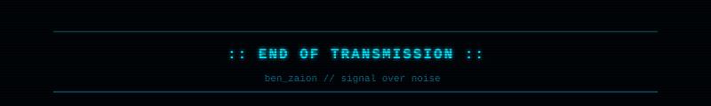

<!-- 
<div align="center">


# `Ben-Zaion.exe` 🐇

**SOFTWARE DEVELOPER**

</div>


## `C:\ZAION\INSTALLED_COMPONENTS`

**Programming**

`COBOL` · `Java` · `C#` · `.NET` · `Python`

**Enterprise Systems**

`IBM i / AS400` · `DB2` · `SQL` · `PL/SQL`

**Tools**

`Git` · `GitHub` · `VS Code` · `Linux`

## `C:\ZAION\CONTRIBUTION.EXE`

<div align="center">


</div>

--- -->

<div align="center">

<!-- Animated CRT terminal header -->


```
root@zaion:~$ cat ./about.me
```
<br>


</div>

---

```diff
+ C:\ZAION> sysinfo --profile
```
- 👤 `user .........` **Ben Zaion**
- 💼 `role .........` Software Developer
- 🖥️ `stack ........` COBOL · Java · C# / .NET · Python
- 🗄️ `data .........` IBM i / AS400 · DB2 · SQL · PL/SQL
- 🛠️ `tools ........` Git · GitHub · VS Code · Linux
- 📟 `status .......` ONLINE — open to collaborate

---

<div align="center">

**`C:\ZAION\SKILL_MODULES`**


</div>

---

<div align="center">


</div>

---

<div align="center">

**`C:\ZAION\ACTIVITY.LOG`**

<a href="https://github.com/anuraghazra/github-readme-stats">
  
</a>
<a href="https://github.com/denvercoder1/github-readme-streak-stats">
  
</a>

<br><br>

<a href="https://github.com/anuraghazra/github-readme-stats">
  
</a>

</div>

---

<div align="center">

```
C:\ZAION> dial BBS...
```
[](https://github.com/Ben-Zaion)
&nbsp;




</div>


